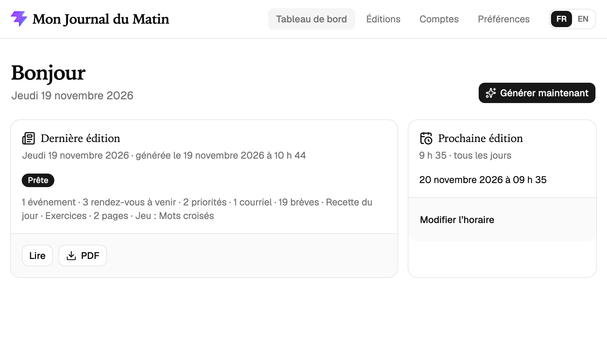
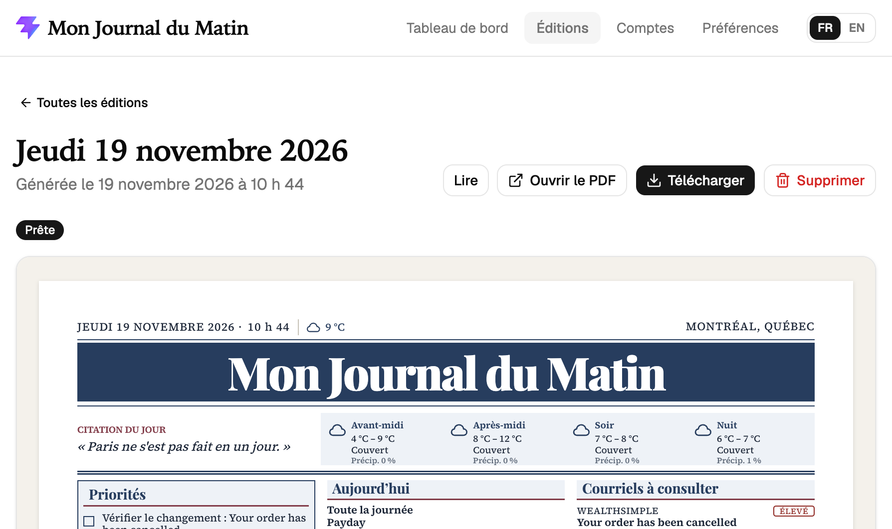
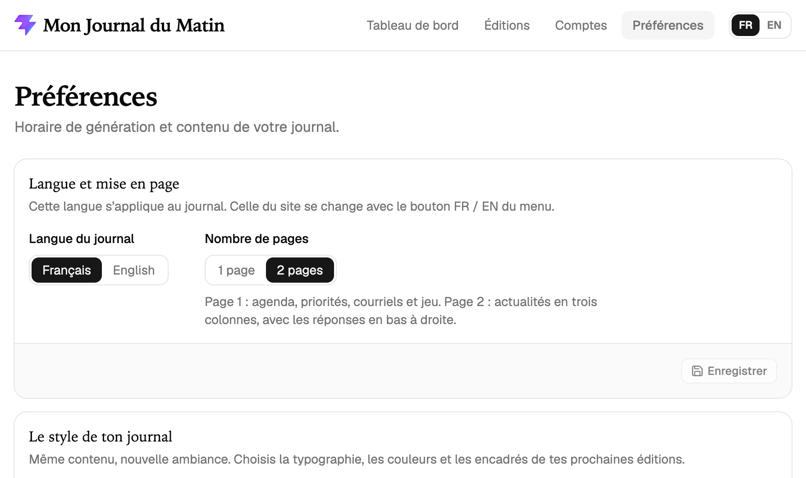
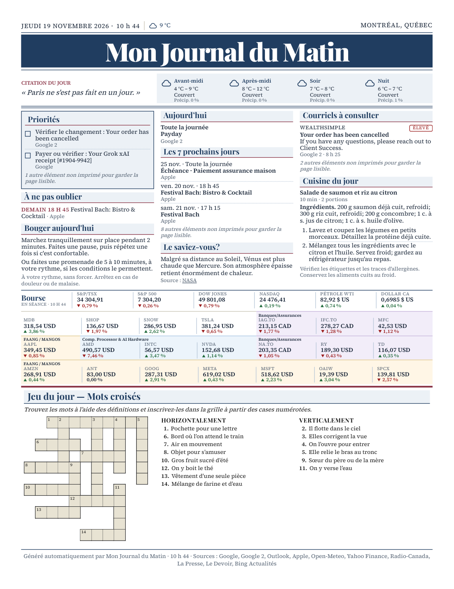
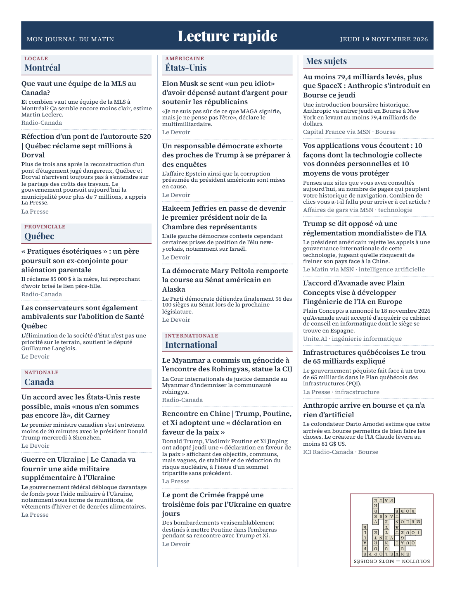
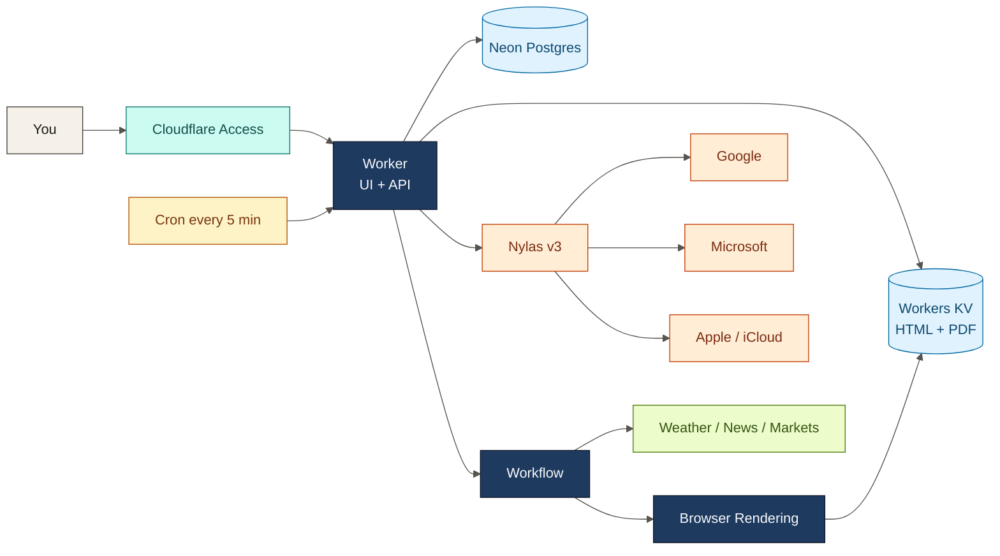
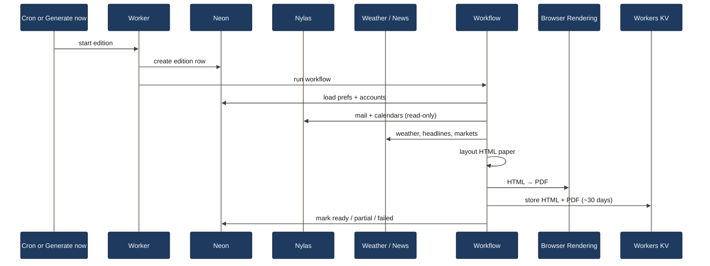
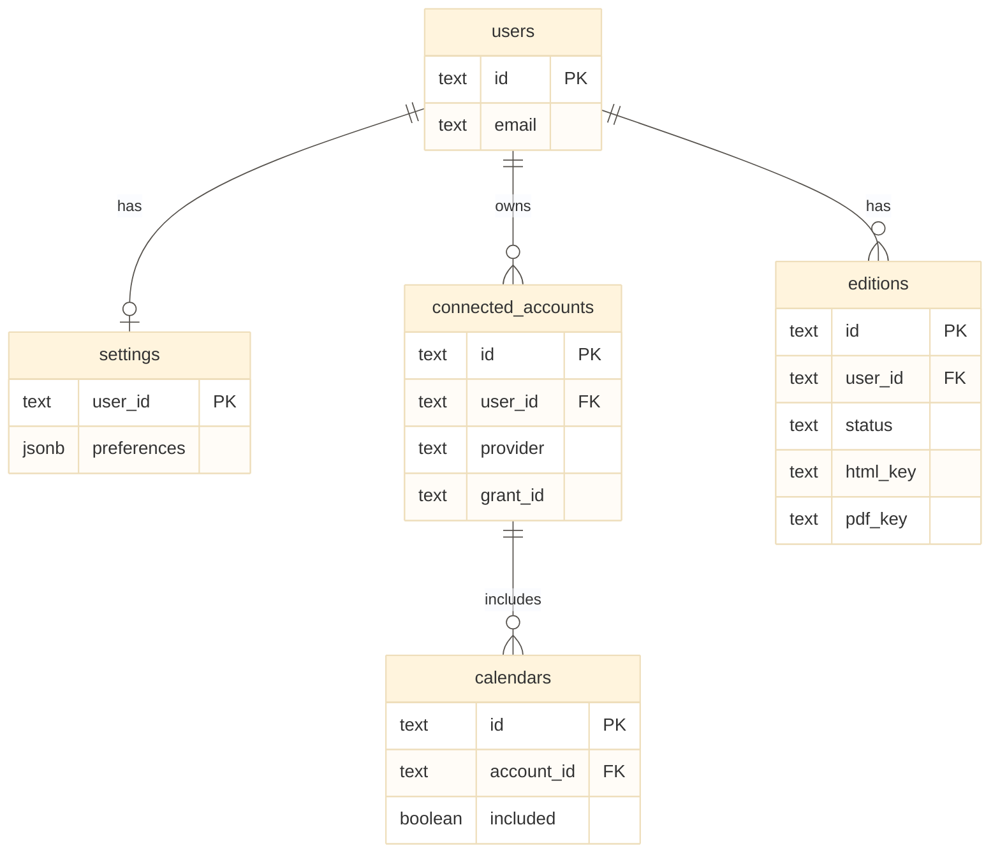

# Morning Press (Mon Journal du Matin)

A personal web app that prepares a **morning newspaper PDF** in French or English from your Google, Outlook, and Apple accounts (email + calendars), plus weather, markets, and news. In 2-page mode, a daily puzzle (sudoku, crossword, or codeword) sits on page 1; page 2 carries summarized headlines by section, with the puzzle answers upside down at the bottom. Open **Read** for a full-page HTML view, or **Download** the PDF. Email delivery and automatic printing are planned later.

**Free, and for everyone.** Clone it, deploy your own instance on Cloudflare + Neon free tiers, and invite the emails you choose. There is no paid Morning Press product—just self-host. (Your site stays private behind Cloudflare Access; the *software* is open to anyone who wants their own paper.)

French docs: [README.fr.md](./README.fr.md), [docs/SETUP.fr.md](./docs/SETUP.fr.md), [docs/USAGE.fr.md](./docs/USAGE.fr.md). Full self-host walkthrough: [docs/SETUP.md](./docs/SETUP.md). Day-to-day use: [docs/USAGE.md](./docs/USAGE.md).

## Look and feel

Real screenshots from a running instance:







### Sample PDF (2 pages)

[Download sample PDF](docs/assets/sample-edition.pdf)

| Page 1 | Page 2 |
| --- | --- |
|  |  |

More detail: [docs/USAGE.md](./docs/USAGE.md#screenshots).

## Features

- Scheduled editions (local time) plus **Generate now**
- Read-only mail and calendars via Nylas (Google, Microsoft, iCloud)
- Weather (Open-Meteo), optional stock watchlist, keyword news (Google/Bing RSS)
- Optional daily game, recipe, and light exercise ideas
- FR/EN site UI and independent paper language
- Installable PWA (home-screen app)

## Architecture



| Piece | Technology | Role |
| --- | --- | --- |
| App & API | Cloudflare Workers (React + Hono) | One Worker serves the UI and API |
| Login gate | Cloudflare Access (Zero Trust) | Only allowlisted emails reach the site |
| Accounts | Nylas v3 | Google, Outlook, and iCloud through one read-only API |
| Data | Neon Postgres + Drizzle | Connected accounts, calendars, preferences, edition history |
| Schedule | Cron Trigger (every 5 min) | Starts an edition at the chosen local time |
| Generation | Cloudflare Workflows | Retries failed steps automatically |
| PDF | Browser Rendering (Browser Run) | Turns the HTML paper into a Letter-size PDF |
| Files | Workers KV | HTML and PDF kept ~30 days |
| Weather / news | Open-Meteo, Google News & Bing News RSS | Free, no API keys |

A personal instance fits on Cloudflare and Neon free tiers.

### Edition generation



### Data model (simplified)



## What you need

### Cloud accounts

| Account | Purpose | Free-tier notes |
| --- | --- | --- |
| [Cloudflare](https://dash.cloudflare.com) | Workers, KV, Workflows, Browser Rendering, Cron | Browser Run ~10 minutes/day |
| [Cloudflare Zero Trust](https://one.dash.cloudflare.com) | Access policy + JWT verification | Free team; a card may be requested with no charge |
| [Neon](https://console.neon.tech) | Postgres | Scales to zero when idle |
| [Nylas v3](https://dashboard-v3.nylas.com) | Mail/calendar connectors | Sandbox limited to **5** connected accounts |

End users also need Google, Microsoft, and/or Apple accounts to connect inside the app. Apple requires an [app-specific password](https://account.apple.com).

No keys are required for Open-Meteo or the news RSS feeds.

### Local tools

- Node.js 22+ and npm
- Wrangler (via the project: `npx wrangler`)
- [cloudflared](https://developers.cloudflare.com/cloudflare-one/connections/connect-apps/install-and-setup/installation/) for remote KV/Browser bindings while Access protects the Worker (`brew install cloudflared` on macOS)

## Quick start

1. Clone the repo and install dependencies:

   ```sh
   git clone <your-fork-or-clone-url>
   cd morning-press
   npm install
   ```

2. Follow **[docs/SETUP.md](./docs/SETUP.md)** to create KV + Neon, configure Nylas and Access, set secrets, run migrations, and deploy.

3. For local development:

   ```sh
   cp .dev.vars.example .dev.vars   # fill DATABASE_URL, NYLAS_*, DEV_AUTH_EMAIL
   npm run dev                     # http://localhost:5173
   ```

`DEV_AUTH_EMAIL` bypasses Cloudflare Access **on localhost only**.

After deploy, open `https://<your-worker>.<subdomain>.workers.dev`, sign in through Access, connect accounts under **Accounts**, set **Preferences**, then **Generate now** on the dashboard.

## Scripts

| Command | Purpose |
| --- | --- |
| `npm run dev` | Local Vite + Worker (`http://localhost:5173`) |
| `npm run typecheck` | TypeScript (client and Worker) |
| `npm test` | Unit tests (Vitest) |
| `npm run lint` | Lint (oxlint) |
| `npm run build` | Production build |
| `npm run deploy` | Build and deploy to Cloudflare |
| `npm run db:generate` | Create a Drizzle SQL migration |
| `npm run db:migrate` | Apply migrations to Neon (`DATABASE_URL` from `.dev.vars`) |
| `npm run cf-typegen` | Regenerate `worker-configuration.d.ts` after Wrangler config changes |

PDF layout regression tests need a local Chrome:

```sh
CHROME_PATH="/Applications/Google Chrome.app/Contents/MacOS/Google Chrome" npm test -- worker/edition/print.test.ts
# Linux: CHROME_PATH=google-chrome npm test -- worker/edition/print.test.ts
```

Without `CHROME_PATH`, those PDF tests are skipped.

## Project layout

```text
src/            React UI (TanStack Router/Query, shadcn/ui, Tailwind)
public/         Favicon, PWA icons, offline service worker
shared/         Shared Zod schemas and types
worker/
  api/          Hono API (accounts, Nylas OAuth, settings, editions) + web manifest
  auth/         Cloudflare Access JWT checks
  db/           Drizzle schema and queries
  edition/      Content selection, HTML layout, reader controls, i18n
  daily/        Recipes, sourced facts, exercises
  games/        Sudoku, crossword, codeword
  nylas/        Nylas v3 client (read-only)
  schedule/     Local-time scheduling and Cron
  sources/      Accounts, weather, news
  workflow/     Generation workflow (data → HTML → PDF)
drizzle/        SQL migrations
docs/           Setup and usage guides
```

## Security and privacy

- Access gates the site; the Worker also verifies the Access JWT on every request.
- Nylas scopes are read-only (`gmail.readonly`, `calendar.readonly`, `Mail.Read`, `Calendars.Read`).
- The paper shows sender, subject, and a short snippet—not full message bodies.
- Newspaper HTML is escaped and served under a strict CSP `sandbox`.
- Secrets live in Cloudflare Secrets / `.dev.vars` (gitignored)—never in source.

## Free-tier limits

- **Browser Run**: about 10 minutes/day (enough for one or two editions).
- **Workflows**: tight per-step CPU; each connected account is its own step.
- **KV**: 1,000 writes/day and 1,000 deletes/day (about 2 of each per edition create/delete).
- **Neon**: sleeps when idle; the Cron checks KV first so it does not wake the DB every 5 minutes.
- Editions older than 180 days are cleaned up automatically; HTML/PDF objects in KV expire after ~30 days.

## License / publishing

`package.json` sets `"private": true` so the package is not published to npm. The GitHub repository can still be public for self-hosting. Add a `LICENSE` file if you want an explicit open-source license.
