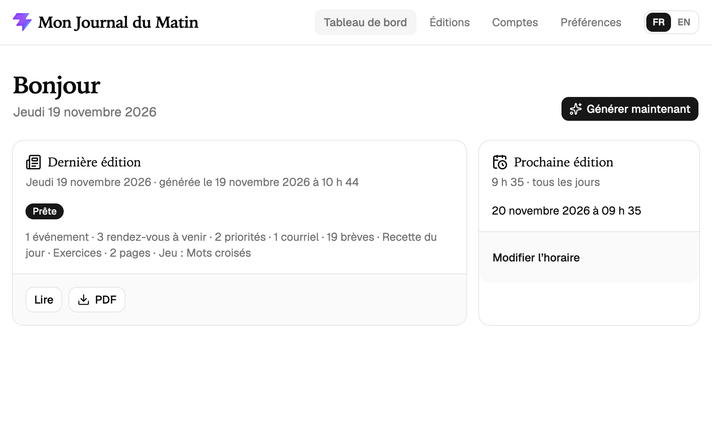
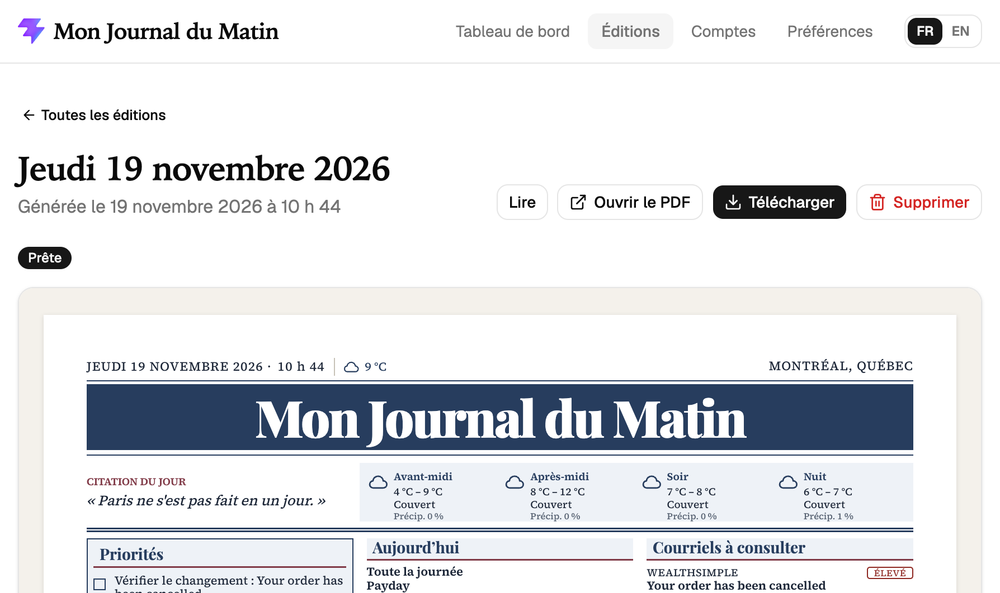
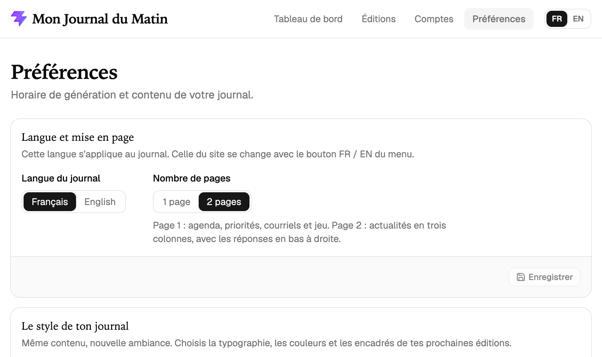
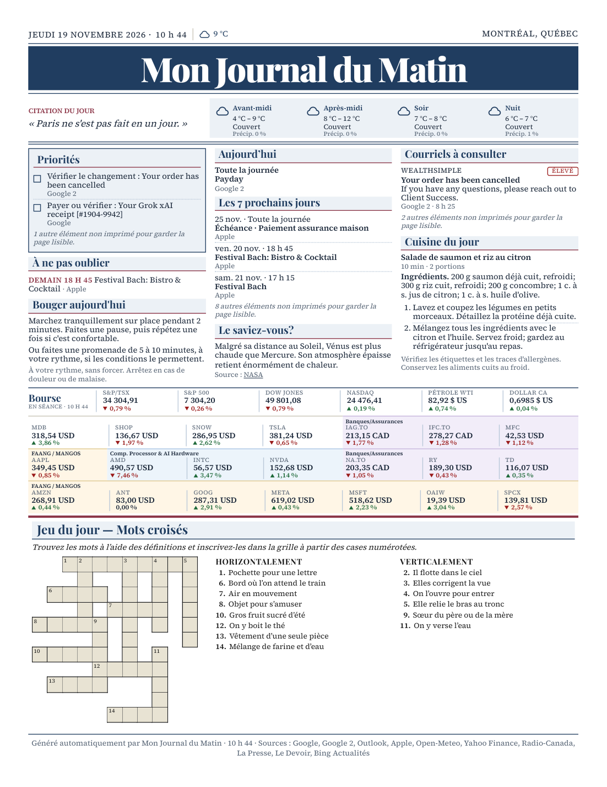
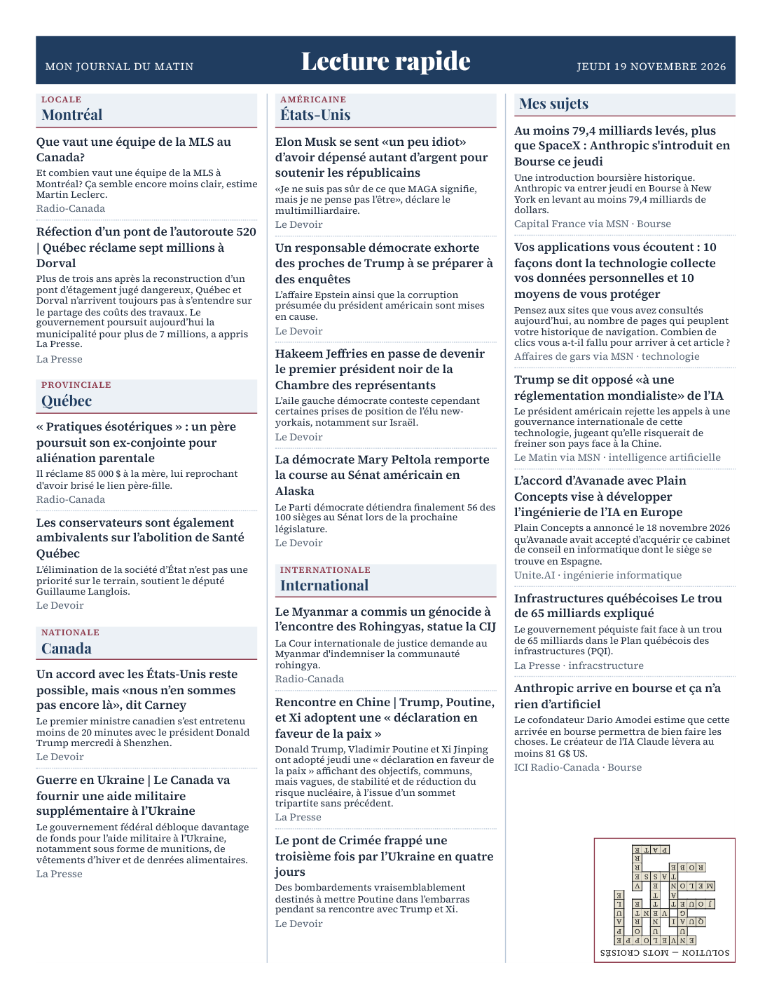
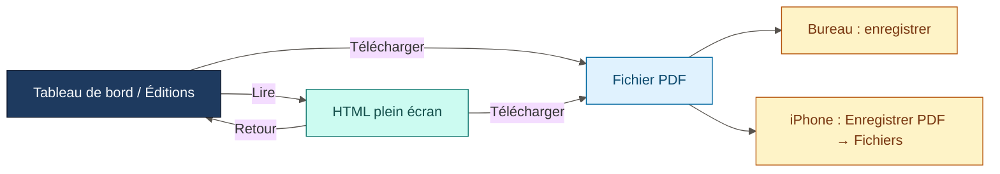

# Utilisation

> English: [USAGE.md](./USAGE.md)

Comment utiliser au quotidien une instance Morning Press déjà en ligne. Pour l’installation et les comptes cloud, voir [SETUP.fr.md](./SETUP.fr.md).

Morning Press est **gratuit à auto-héberger, pour tout le monde** : déployez sur les forfaits gratuits Cloudflare + Neon, puis autorisez les courriels qui doivent utiliser *votre* instance. Access garde chaque site privé ; le projet, lui, est pensé pour quiconque veut son journal personnel.

## Captures d’écran

Vraies captures d’une instance en ligne. Votre thème, langue et contenu différeront.

### Tableau de bord

### Page édition

### Préférences

### Exemple de PDF

[Télécharger le PDF d’exemple](./assets/sample-edition.pdf)

| Page 1 | Page 2 |
| --- | --- |
|  |  |

## Langues

- **Langue du site** — bascule FR / EN dans l’en-tête. Conservée dans le navigateur. À la première visite, elle suit la langue du journal.
- **Langue du journal** — réglée dans **Préférences**. Indépendante de la langue de l’interface.

## Comptes

Ouvrez **Comptes** et connectez Google, Outlook et/ou Apple (iCloud). L’accès est en **lecture seule**.

Pour chaque compte vous pouvez :

- Inclure ou exclure le **courriel** du journal
- Choisir un filtre : tous, non lus, importants, ou importants + non lus
- Sélectionner quels **calendriers** apparaissent dans le journal

Apple/iCloud exige un [mot de passe pour app](https://account.apple.com), pas le mot de passe principal Apple ID.

Si une connexion expire, le tableau de bord propose de reconnecter.

## Préférences

Chaque section a son propre **Enregistrer**. **Tout enregistrer** en bas applique toutes les sections modifiées. Quitter avec des changements non sauvés affiche un résumé (avant → après).

Réglages typiques :

| Zone | Ce que vous configurez |
| --- | --- |
| Journal | Langue, 1 ou 2 pages, style et intensité |
| Horaire | Jours actifs, heure locale, fuseau, ville (météo) |
| Lecture rapide | Lieux/sujets par portée, jusqu’à 10 sujets perso |
| Marchés | Liste de suivi optionnelle (symbole ou entreprise), catégories et ordre |
| Courriel | Interrupteur global, mots-clés prioritaires, expéditeurs ignorés |
| Jeu | Uniquement en mode 2 pages : quels casse-têtes peuvent apparaître |
| Recette / exercice | Optionnels ; désactivés par défaut |

Enregistrer les préférences n’affecte que les **nouvelles** éditions. Les éditions déjà générées restent telles quelles.

Utilisez l’aperçu de style pour essayer des looks avec des données fictives sans enregistrer.

## Tableau de bord et éditions

- **Générer maintenant** lance une édition tout de suite (sous réserve des limites Browser Run du forfait gratuit).
- Statut : en cours → prêt / partiel / échec. Partiel = certaines sources ont échoué, mais un journal (ou le HTML) peut quand même exister.
- **Éditions** liste les journaux par date (historique ; fichiers HTML/PDF dans le KV ~30 jours). Dépliez un jour pour voir les anciennes générations du même jour.
- Supprimez une édition ou toutes les éditions d’une date. La suppression retire la ligne Neon et le HTML/PDF du KV. Une génération en cours ne peut pas être effacée, sauf si elle est bloquée depuis plus de ~15 minutes et que le workflow est arrêté.

## Lire et Télécharger

- **Lire** ouvre le journal en HTML plein écran (largeur Lettre) avec une barre : **Retour au journal** et **Télécharger**. Les contrôles sont masqués à l’impression navigateur.
- **Télécharger** / **PDF** enregistre le PDF généré.
  - **Ordinateur :** téléchargement direct.
  - **iPhone / iPad :** le flux prépare le fichier, puis vous touchez **Enregistrer le PDF** et choisissez **Enregistrer dans Fichiers** dans la feuille de partage iOS. Ce second toucher après le chargement est nécessaire pour qu’iOS conserve la permission de partage. Annuler laisse le journal ouvert.

Vous pouvez aussi ouvrir le PDF dans un nouvel onglet depuis la fiche d’une édition, quand disponible.

## Installer comme application (optionnel)

Le site est installable (PWA) : icône sur l’écran d’accueil, plein écran sans chrome du navigateur.

- **iPhone / iPad (Safari) :** Partager → **Sur l’écran d’accueil**.
- **Android (Chrome) :** menu → **Installer l’application** / **Ajouter à l’écran d’accueil**.
- **Bureau :** icône d’installation dans la barre d’adresse Chrome/Edge, ou Safari sur Mac → **Fichier** → **Ajouter au Dock**.

Nom suggéré : « Mon Journal » / « My Paper » (modifiable à l’ajout).

Notes :

- L’app installée utilise Access comme le site. Sur iPhone elle a ses **propres** cookies — connectez-vous une fois dans l’app. Pour éviter une reconnexion quotidienne, allongez la session Access (jusqu’à 1 mois) sous Zero Trust → Access → votre application (et les réglages de session globaux si besoin).
- Si la session expire, utilisez **Se reconnecter** (le mode autonome n’a pas de barre de rechargement habituelle).
- Hors ligne : une page de nouvel essai simple. Le service worker ne met pas les éditions en cache ; les données viennent toujours du serveur.
- Sur téléphone, la page d’édition adapte le journal à la largeur de l’écran ; pincez pour zoomer, ou ouvrez/téléchargez le PDF.

## Ce qui apparaît sur la page

En gros (selon les préférences et l’espace disponible) :

**Page 1** — bandeau, météo, citation, priorités, courriels, recette/exercice optionnels, prochains événements du calendrier, marchés, jeu optionnel, parfois un teaser d’actu locale.

**Page 2** (mode 2 pages) — lecture rapide par section (locale, provinciale, nationale, américaine, internationale, vos sujets) et solutions du jeu à l’envers.

La mise en page est mesurée pour l’impression : le contenu est coupé pour tenir en pages Lettre plutôt que de déborder. Les éléments omis sont indiqués dans le journal quand les listes sont tronquées.

## Rappels vie privée

- Seuls les courriels autorisés passent Cloudflare Access (et `ALLOWED_EMAILS`).
- Courriel/calendrier en lecture seule ; le journal utilise expéditeur, objet et un court extrait.
- Le bruit promotionnel est filtré heuristiquement — ajoutez des expéditeurs ou domaines à la liste d’ignore au besoin.
