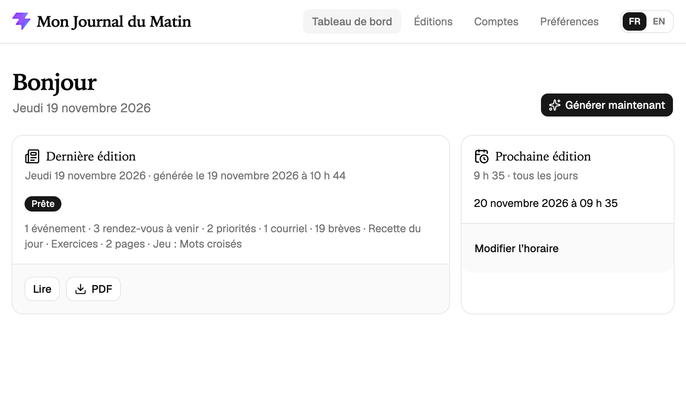
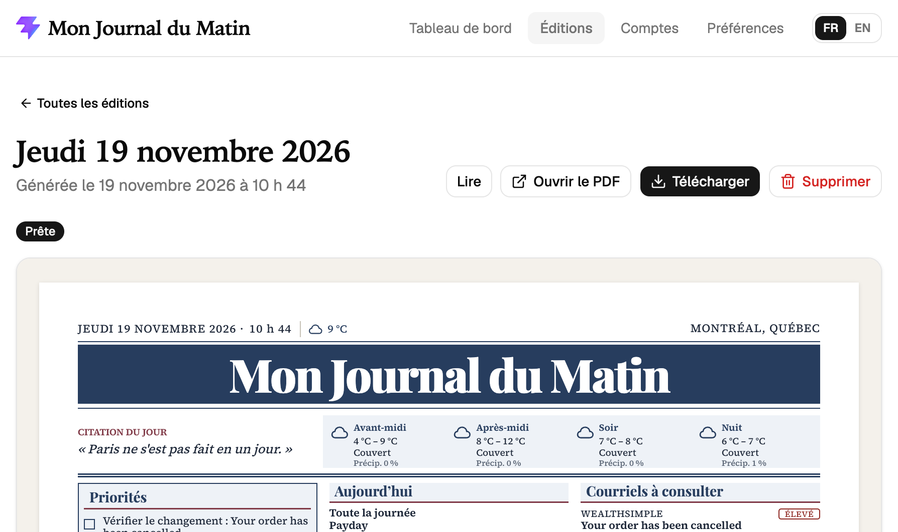
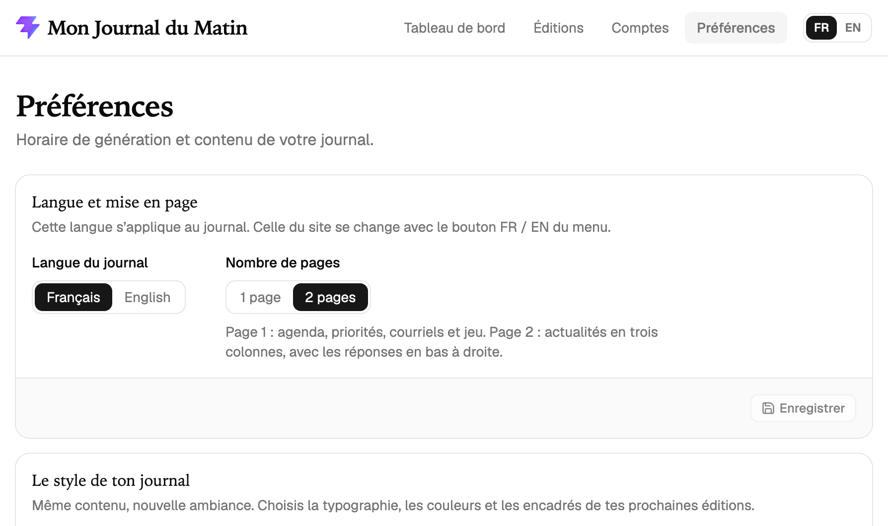
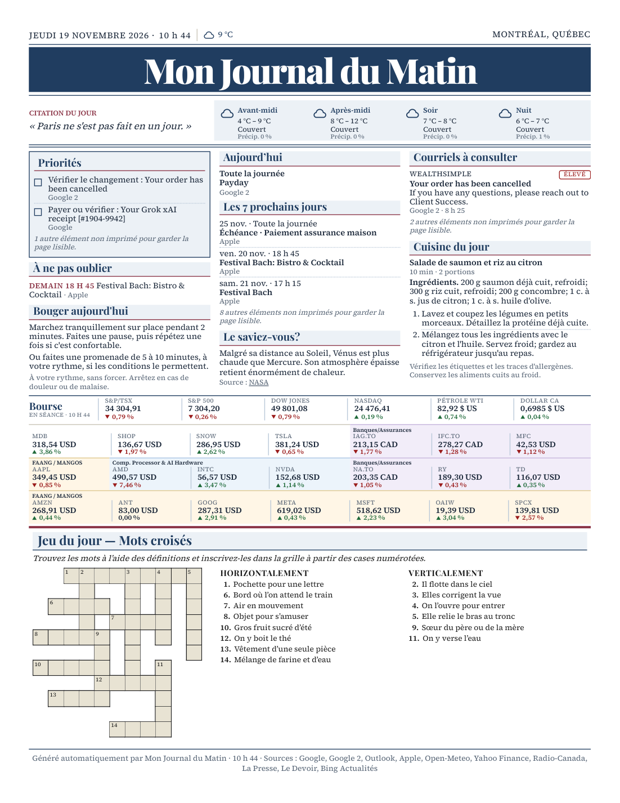
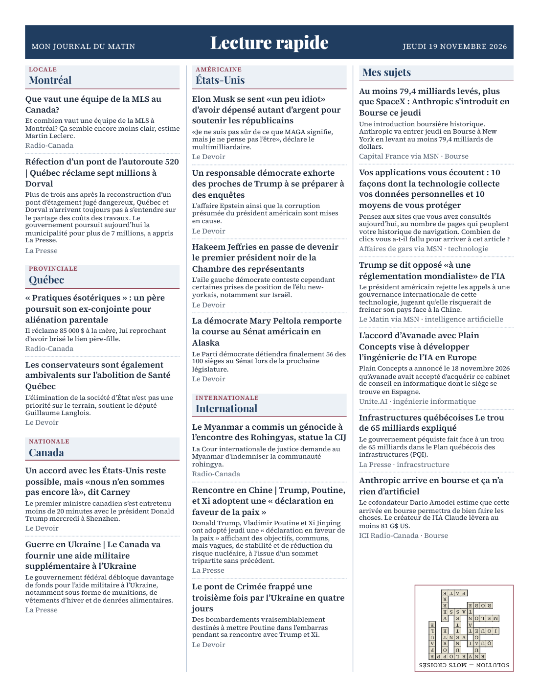
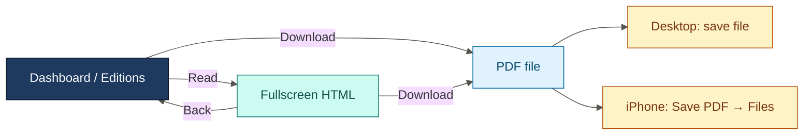

# Usage

> Français : [USAGE.fr.md](./USAGE.fr.md)

How to use a running Morning Press instance day to day. For install and cloud accounts, see [SETUP.md](./SETUP.md).

Morning Press is **free to self-host for anyone**: deploy on Cloudflare + Neon free tiers, then allowlist the emails that should use *your* instance. Access keeps each site private; the project itself is meant for everyone who wants a personal paper.

## Screenshots

Real captures from a live instance. Your theme, language, and content will differ.

### Dashboard

### Edition page

### Preferences

### Sample PDF

[Download sample PDF](./assets/sample-edition.pdf)

| Page 1 | Page 2 |
| --- | --- |
|  |  |

## Languages

- **Site language** — FR / EN toggle in the header. Stored in the browser. On first visit it follows the paper language default.
- **Paper language** — set under **Preferences**. Independent of the site UI language.

## Accounts

Open **Accounts** and connect Google, Outlook, and/or Apple (iCloud). Access is **read-only**.

For each account you can:

- Include or exclude **email** from the paper
- Choose an email filter: all, unread, important, or important + unread
- Select which **calendars** appear in the paper

Apple/iCloud needs an [app-specific password](https://account.apple.com), not your main Apple ID password.

If a connection expires, the dashboard prompts you to reconnect.

## Preferences

Each preferences section has its own **Save**. **Save all** at the bottom applies every dirty section. Leaving with unsaved changes shows a summary (before → after).

Typical settings:

| Area | What you configure |
| --- | --- |
| Paper | Language, 1 or 2 pages, design style and intensity |
| Schedule | Enabled days, local time, timezone, city (weather) |
| Quick read | Per-scope news places/topics, up to 10 personal topics |
| Markets | Optional watchlist (search by symbol or company), categories and order |
| Email | Global toggle, priority keywords, ignored senders |
| Game | Only in 2-page mode: which puzzles may appear |
| Recipe / exercise | Optional; off by default |

Saving preferences affects **new** editions only. Existing editions stay as generated.

Use the style preview to try looks with fictional data without saving.

## Dashboard and editions

- **Generate now** starts an edition immediately (subject to free-tier Browser Run limits).
- Status: running → ready / partial / failed. Partial means some sources failed but a paper (or HTML) may still exist.
- **Editions** lists papers by date (kept in history; HTML/PDF files in KV ~30 days). Expand a day to see older runs from the same date.
- Delete one edition or all editions for a date. Deletion removes the Neon row and the KV HTML/PDF. A run that is still generating cannot be deleted unless it has been stuck longer than ~15 minutes and the workflow is stopped.

## Read and Download

- **Read** opens the paper as full-page HTML (Letter width) with a toolbar: **Back to the paper** and **Download**. Toolbar controls are hidden when printing from the browser.
- **Download** / **PDF** saves the generated PDF.
  - **Desktop:** direct download.
  - **iPhone / iPad:** the in-app flow prepares the file, then you tap **Save PDF** and choose **Save to Files** in the iOS share sheet. That second tap after loading is required for iOS to keep the share permission. Canceling leaves the paper open.

You can also open the PDF in a new tab from an edition’s detail page when available.

## Install as an app (optional)

The site is installable (PWA): home-screen icon, fullscreen without the browser chrome.

- **iPhone / iPad (Safari):** Share → **Add to Home Screen**.
- **Android (Chrome):** menu → **Install app** / **Add to Home Screen**.
- **Desktop:** install icon in Chrome/Edge address bar, or Safari on Mac → **File** → **Add to Dock**.

Suggested name: “My Paper” / “Mon Journal” (editable when adding).

Notes:

- The installed app uses Access like the website. On iPhone it has its **own** cookies—sign in once inside the app. To avoid daily re-login, lengthen the Access session (up to 1 month) under Zero Trust → Access → your application (and global session settings if needed).
- If the session expires, use **Sign in again** (standalone mode has no normal reload chrome).
- Offline: a simple retry page. The service worker does not cache editions; data always comes from the server.
- On a phone, the edition page scales the paper to the screen width; pinch to zoom, or open/download the PDF.

## What ends up on the page

Roughly (depending on preferences and available space):

**Page 1** — masthead, weather, quote, priorities, emails, optional recipe/exercise, upcoming calendar items, markets, optional game, and sometimes a local news teaser.

**Page 2** (2-page mode) — quick-read news by section (local, provincial, national, US, international, your topics) and upside-down game answers.

Layout is measured for print so content is cut to fit Letter pages rather than overflowing. Omitted items are noted in the paper when lists are trimmed.

## Privacy reminders

- Only allowlisted emails pass Cloudflare Access (and `ALLOWED_EMAILS`).
- Mail/calendar access is read-only; the paper uses sender, subject, and a short snippet.
- Promotional noise is filtered heuristically—add senders or domains to the ignore list when needed.
